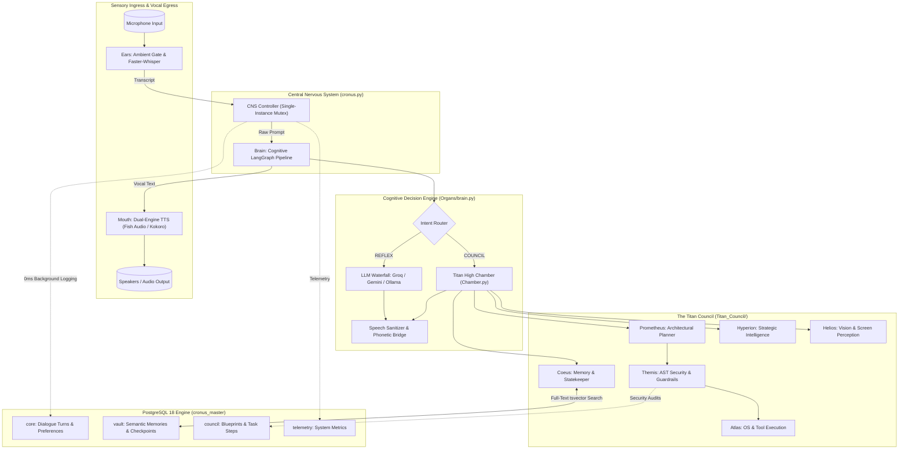
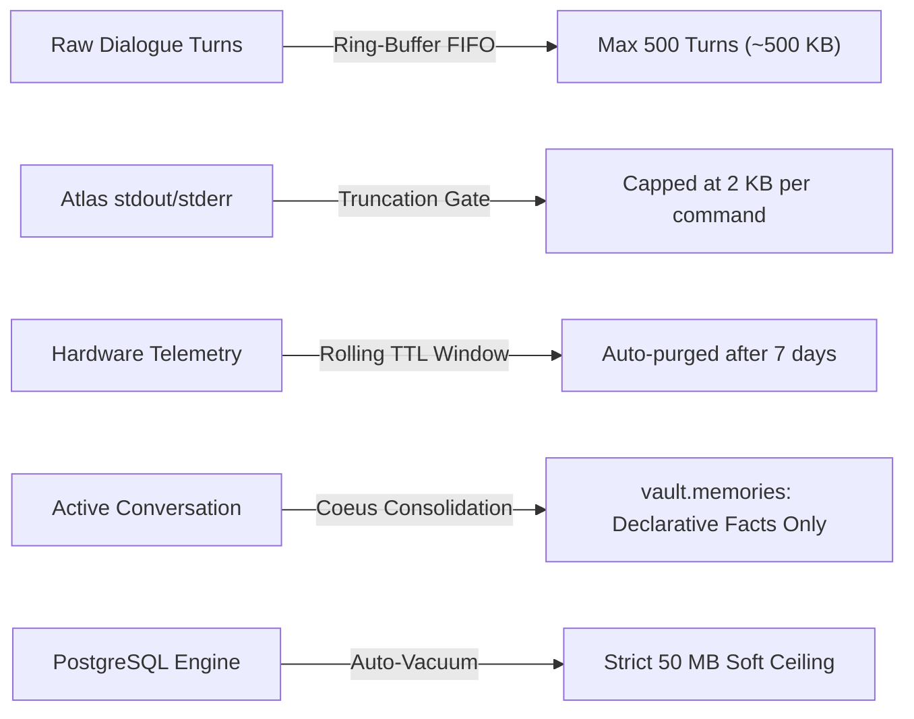

# CRONUS — Sovereign Artificial Super-Intelligence (ASI) Agentic System

<div align="center">

```
   ██████╗██████╗  ██████╗ ███╗   ██╗██╗   ██╗███████╗
  ██╔════╝██╔══██╗██╔═══██╗████╗  ██║██║   ██║██╔════╝
  ██║     ██████╔╝██║   ██║██╔██╗ ██║██║   ██║███████╗
  ██║     ██╔══██╗██║   ██║██║╚██╗██║██║   ██║╚════██║
  ╚██████╗██║  ██║╚██████╔╝██║ ╚████║╚██████╔╝███████║
   ╚═════╝╚═╝  ╚═╝ ╚═════╝ ╚═╝  ╚═══╝ ╚═════╝ ╚══════╝
```

**Sovereign Cognitive Reasoning & Multi-Agent Execution Network**  
*Built exclusively for Creator Soumya Roy*

[](Database/client.py)
[](Organs/brain.py)
[](Organs/mouth.py)
[](pyproject.toml)
[](pyproject.toml)

</div>

---

## 🏛️ Executive Architectural Overview

**CRONUS** is a sovereign, dual-tier autonomous AI assistant engineered with a biologically inspired central nervous system coupled to a silent multi-agent executive council (**The Titan Council**).

Unlike conventional voice assistants that merely invoke a single prompt-response loop, CRONUS operates as an **embodied operating system daemon**:

1. **The Sovereign Front (CRONUS)**:
   - **Ears (Sensory Intake)**: Continuous microphone capture using `SoundDevice` and hardware-accelerated `Faster-Whisper` (CTranslate2 / CUDA) with real-time ambient noise calibration and a 0.45s phrase gating mechanism.
   - **Brain (Cognitive Router)**: Hierarchical LangGraph `StateGraph` network executing intent classification, micro-reflexes, memory retrieval, and multi-provider LLM waterfall routing.
   - **Mouth (Dual-Engine Speech Synthesis)**: High-fidelity cloud neural synthesis via **Fish Audio S2.1-pro-free** (featuring voices such as Kevin Conroy / Dark Knight, Morgan Freeman, and David Attenborough), with zero-latency failover to a local GPU **Kokoro-82M** neural engine. Single-instance named mutex enforcement and 0.65s acoustic drain eliminate phantom feedback loops.
2. **The High Chamber (Titan Council)**:
   - A specialized multi-agent legion running in the background. Titans plan tasks, generate deterministic shell/code commands, audit security via AST inspection, and curate long-term persistent state without speaking over CRONUS (**Sole Voice Mandate**).
3. **The Memory Vault (PostgreSQL 18)**:
   - Fully persistent relational and full-text search backend running locally (`localhost:5432`), housing 12 structured tables across 4 isolated schemas with guaranteed ring-buffer containment.



---

## 🗄️ Database & Memory Persistence Architecture

CRONUS is anchored by a high-performance **PostgreSQL 18** enterprise engine running locally, providing atomic ACID durability, sub-millisecond session logging, and relational state coordination across all organs and Titan agents.

### PostgreSQL 18 Cluster Specifications

| Parameter | Configuration Setting | Physical Location / Details |
| :--- | :--- | :--- |
| **Engine Version** | PostgreSQL 18.0 (x64) | `C:\Program Files\PostgreSQL\18\bin` |
| **Cluster Host** | `localhost:5432` | Standard PostgreSQL loopback socket |
| **Master Database** | `cronus_master` | Isolated application database |
| **Physical Data Directory** | `D:\Codes\PostgreSql` | Dedicated SSD partition (~96.6 MB cluster size) |
| **Active DB Footprint** | ~8.65 MB (8,861,375 bytes) | Compact, optimized relational storage |
| **Connection Engine** | `asyncpg` via [Database/client.py](Database/client.py) | High-speed binary protocol async driver |

### Multi-Loop Resilient Connection Engine

To eliminate common asynchronous pitfalls in Python (such as `RuntimeError: Event loop is closed` or `cannot perform operation: another operation is in progress`), the CRONUS database client introduces an isolated worker architecture:

- **Dedicated Background Event Loop**: A persistent daemon thread (`CronusDBWorker`) maintains an independent event loop (`_db_loop`) and manages the `asyncpg.Pool` (2 to 10 connections).
- **Zero-Latency Fire-and-Forget API (`schedule_on_db_loop`)**: Spoken dialogue turns and telemetry are dispatched to the database without awaiting completion, yielding **0.00 ms latency impact** on real-time voice replies.
- **Synchronous-Safe Query Dispatch (`run_on_db_loop`)**: Blocking or non-async callers can safely retrieve preferences and search memories without thread collisions or deadlocks.
- **Circuit-Breaker Fault Tolerance**: If the PostgreSQL service is temporarily unreachable, all operations fail gracefully into a resilient offline mode without crashing the assistant.

---

### Detailed Schema & Table Directory (All 12 Tables)

The `cronus_master` database organizes data into **4 isolated schemas**, separating conversational telemetry, council deliberations, long-term memory vaults, and hardware metrics.

```
cronus_master
├── 📁 core          (Conversational state, turn-by-turn history, user preferences)
├── 📁 council       (Titan execution blueprints, task steps, security audits, debates)
├── 📁 vault         (Long-term semantic memories, tsvector indexes, checkpoints)
└── 📁 telemetry     (Hardware utilization, performance metrics, sandbox simulations)
```

#### 1. Schema: `core` (Conversational Nervous System)

| Table | Size | Key Columns & Data Types | Purpose & Operational Logic |
| :--- | :--- | :--- | :--- |
| [`core.conversations`](Database/client.py#L182) | 16 kB | `session_id` (uuid, PK)<br>`started_at` (timestamptz)<br>`ended_at` (timestamptz)<br>`metadata` (jsonb) | High-level session boundaries. Generated at startup or when starting a new conversational stream. |
| [`core.dialogue_turns`](Database/client.py#L186) | 64 kB | `turn_id` (bigint, PK)<br>`session_id` (uuid)<br>`user_prompt` (text)<br>`cleaned_speech_response` (text)<br>`model_used` (varchar)<br>`ear_latency_ms` (int)<br>`brain_latency_ms` (int)<br>`mouth_latency_ms` (int)<br>`intent` (varchar)<br>`created_at` (timestamptz) | Complete historical record of every spoken interaction. Captures exact latency metrics across ears, brain, and mouth, recording the model utilized and classified intent (`REFLEX`, `COUNCIL`). |
| [`core.user_preferences`](Database/client.py#L267) | 32 kB | `key` (varchar, PK)<br>`value` (text)<br>`category` (varchar)<br>`metadata` (jsonb)<br>`updated_at` (timestamptz) | Key-value store for creator preferences, operational flags, and system traits. Employs `ON CONFLICT (key) DO UPDATE` for atomic upserts. |

#### 2. Schema: `council` (Multi-Agent Blueprints & Security Audits)

| Table | Size | Key Columns & Data Types | Purpose & Operational Logic |
| :--- | :--- | :--- | :--- |
| [`council.blueprints`](Database/client.py#L323) | 64 kB | `blueprint_id` (uuid, PK)<br>`goal` (text)<br>`rationale` (text)<br>`planner_model` (varchar)<br>`total_steps` (int)<br>`fallback_strategy` (text)<br>`raw_json` (jsonb)<br>`created_at` (timestamptz) | Structured execution plans synthesized by **Prometheus**. Stores goal decomposition, step counts, dependency trees, and fallback paths. |
| [`council.task_steps`](Database/client.py#L357) | 16 kB | `step_id` (uuid, PK)<br>`blueprint_id` (uuid, FK)<br>`step_number` (int)<br>`title` (text)<br>`action_type` (varchar)<br>`command_payload` (text)<br>`target_path` (text)<br>`risk_level` (varchar)<br>`status` (varchar)<br>`exit_code` (int)<br>`stdout` (text)<br>`stderr` (text)<br>`execution_duration_sec` (float8)<br>`created_at` (timestamptz) | Granular execution logs generated by **Atlas**. Records every shell invocation, file edit, or tool call along with exit codes, timing, and truncated output streams. |
| [`council.security_audits`](Database/client.py#L390) | 16 kB | `audit_id` (uuid, PK)<br>`step_id` (uuid)<br>`target_name` (text)<br>`command_or_code` (text)<br>`verdict` (varchar)<br>`score` (float8)<br>`violations` (jsonb)<br>`summary` (text)<br>`created_at` (timestamptz) | Independent security and safety verification records authored by **Themis**. Audits all AST nodes and shell commands for red-team patterns, destructive flags, and forbidden paths. |
| [`council.deliberations`](Database/client.py#L1) | 16 kB | `deliberation_id` (uuid, PK)<br>`directive` (text)<br>`dossier_json` (jsonb)<br>`consensus_text` (text)<br>`created_at` (timestamptz) | Multi-agent synthesis records documenting high-level Council debates, consensus determinations, and strategic dossiers from **Hyperion**. |

#### 3. Schema: `vault` (Long-Term Memory & Full-Text Lexical Search)

| Table | Size | Key Columns & Data Types | Purpose & Operational Logic |
| :--- | :--- | :--- | :--- |
| [`vault.memories`](Database/client.py#L420) | 56 kB | `record_id` (uuid, PK)<br>`record_type` (varchar)<br>`key` (varchar)<br>`content` (text)<br>`metadata` (jsonb)<br>`tsv` (tsvector)<br>`created_at` (timestamptz) | Semantic long-term memory store. Features a dedicated **PostgreSQL GIN full-text index** (`idx_vault_memories_tsv`) over `tsv`. Enables sub-millisecond lexical search via `ts_rank_cd(tsv, plainto_tsquery('english', query))`. |
| [`vault.checkpoints`](Database/client.py#L1) | 16 kB | `checkpoint_id` (varchar, PK)<br>`thread_id` (varchar)<br>`step_index` (int)<br>`state_payload` (jsonb)<br>`created_at` (timestamptz) | LangGraph checkpoint repository, supporting pause, rewind, replay, and multi-turn state resumption across system reboots. |
| [`vault.semantic_embeddings`](Database/client.py#L1) | 16 kB | `id` (uuid, PK)<br>`content` (text)<br>`category` (varchar)<br>`tags` (text[])<br>`embedding` (float8[])<br>`metadata` (jsonb)<br>`created_at` (timestamptz) | High-dimensional embedding storage for future vector-similarity clustering and hybrid semantic retrieval. |

#### 4. Schema: `telemetry` (System Diagnostics & Sandbox Simulation)

| Table | Size | Key Columns & Data Types | Purpose & Operational Logic |
| :--- | :--- | :--- | :--- |
| [`telemetry.system_metrics`](Database/client.py#L467) | 8 kB | `id` (bigint, PK)<br>`cpu_pct` (float8)<br>`ram_pct` (float8)<br>`gpu_mem_used_mb` (float8)<br>`created_at` (timestamptz) | Time-series hardware utilization telemetry tracking CPU workload, system RAM percentage, and NVIDIA GPU VRAM occupancy. |
| [`telemetry.simulations`](Database/client.py#L1) | 16 kB | `sim_id` (uuid, PK)<br>`directive` (text)<br>`risk_score` (float8)<br>`details` (jsonb)<br>`created_at` (timestamptz) | Sandbox simulation results evaluating hypothetical execution plans before deploying modifications to the host operating system. |

---

### 🛡️ Fixed-Ceiling Storage Strategy (Storage Containment Plan)

To guarantee that database operations do not consume unbounded disk space over weeks or months of continuous execution, CRONUS implements a **multi-tiered storage containment policy**:



1. **FIFO Ring-Buffer for Dialogue Turns**:
   - `core.dialogue_turns` is managed with a strict 500-turn FIFO ring buffer.
   - When the ceiling is reached, the oldest turns are pruned, maintaining the table footprint under ~500 KB regardless of runtime duration.
2. **Atlas Command Output Truncation Gate**:
   - Raw command outputs (`stdout`/`stderr`) logged in `council.task_steps` are automatically truncated to a maximum of **2,048 characters (2 KB)**.
   - Full compiler outputs, pip dependency logs, and large file dumps are summarized rather than stored verbatim.
3. **Rolling Telemetry Expiration (7-Day TTL)**:
   - System metrics in `telemetry.system_metrics` are maintained on a 7-day rolling window. Expired metrics are deleted during background maintenance cycles.
4. **Coeus Long-Term Memory Consolidation**:
   - Instead of storing complete conversational transcripts forever, **Coeus** periodically consolidates key facts into compact declarative sentences in `vault.memories` (e.g., *"Soumya Roy prefers Dark Knight voice"*).
   - This keeps the searchable knowledge base rich and semantic while shedding multi-megabyte raw conversational text.
5. **PostgreSQL Auto-Vacuum & Space Reclamation**:
   - Standard autovacuum daemon settings reclaim dead row tuples automatically.
   - The entire database (`cronus_master`) is configured to operate within a strict **50 MB storage envelope**, preserving drive health on the host workstation.

---

## ⚡ Active Technologies & Engine Stack

Below is an audit of the technologies currently operating in the codebase:

| Technology | Domain | Location in Codebase | How It Is Used |
| :--- | :--- | :--- | :--- |
| **PostgreSQL 18** | Enterprise Relational Engine | [Database/client.py](Database/client.py) | Houses 12 tables across 4 schemas (`core`, `council`, `vault`, `telemetry`). Powers session persistence, GIN full-text search, and multi-agent coordination. |
| **asyncpg** | Binary DB Driver | [Database/client.py](Database/client.py) | Asynchronous connection pool interfacing with PostgreSQL over native binary protocol. |
| **LangChain** | LLM Abstraction | [llm.py](llm.py), [Organs/brain.py](Organs/brain.py) | Unified model interface across Groq (`ChatGroq`), Google Gemini (`ChatGoogleGenerativeAI`), NVIDIA NIM (`ChatOpenAI`), and local Ollama (`ChatOllama`). |
| **LangGraph** | Multi-Graph Cognitive Engine | [Organs/brain.py](Organs/brain.py) | Stateful cognitive graphs utilizing `StateGraph`. Manages input preparation, LLM reasoning, speech sanitization, and Titan Council routing. |
| **Fish Audio API** | Primary Neural Cloud TTS | [Organs/mouth.py](Organs/mouth.py) | Ultra-expressive S2.1 neural synthesis. Features Dark Knight, Morgan Freeman, GLaDOS, and David Attenborough voices with streaming chunks. |
| **Kokoro-82M TTS** | Local Neural TTS Fallback | [Organs/mouth.py](Organs/mouth.py) | Lightweight local deep learning neural text-to-speech engine running locally on PyTorch with CUDA acceleration (`am_onyx` voice). |
| **Faster-Whisper** | Speech-to-Text (STT) | [Organs/ears.py](Organs/ears.py) | CTranslate2-accelerated Whisper model running on GPU with real-time ambient noise energy calibration and phrase duration gating. |
| **PyTorch (CUDA 12.8)** | Deep Learning Runtime | Environment & Core Models | Hardware-accelerated tensor computations on NVIDIA GPUs for Whisper and Kokoro audio processing. |
| **SoundDevice & PyAudio** | Low-Latency Audio I/O | [Organs/ears.py](Organs/ears.py), [Organs/mouth.py](Organs/mouth.py) | High-speed PCM streaming for microphone recording and speaker playback. |
| **Pydantic (V2)** | Strict Schema Validation | [llm.py](llm.py), [Titan_Council/](Titan_Council/) | Runtime schema enforcement for structured LLM outputs, blueprint validation, and API tokens. |

---

## 🏛️ The Titan Council (Multi-Agent Legion)

When a complex directive requires more than a simple reflex answer, the CRONUS Brain routes execution to the **Titan Council High Chamber** (`Titan_Council/Chamber.py`). The Council operates under a strict **Sole Voice Mandate**: only CRONUS speaks aloud, while the Titans execute silently in the background.

```
                    ┌─────────────────────────┐
                    │      CRONUS (ASI)       │
                    │   Sole Voice & Monarch  │
                    └────────────┬────────────┘
                                 │
                   ┌─────────────┴─────────────┐
                   ▼                           ▼
        [CRONUS 👑] [REFLEX]           [CRONUS 👑]
        Immediate Reflex Turn          Council Execution
                                               │
                         ┌─────────────────────┴─────────────────────┐
                         ▼                                           ▼
             ┌───────────────────────┐                   ┌───────────────────────┐
             │   PROMETHEUS          │                   │   THEMIS              │
             │   Architectural DAG   │                   │   AST Security Guard  │
             └───────────┬───────────┘                   └───────────┬───────────┘
                         │                                           │
                         ▼                                           ▼
             ┌───────────────────────┐                   ┌───────────────────────┐
             │   ATLAS               │                   │   COEUS               │
             │   OS & Tool Execution │                   │   PostgreSQL Vault    │
             └───────────┬───────────┘                   └───────────┬───────────┘
                         │                                           │
                         ▼                                           ▼
             ┌───────────────────────┐                   ┌───────────────────────┐
             │   HYPERION            │                   │   HELIOS              │
             │   Strategic Synthesis │                   │   Screen Perception   │
             └───────────────────────┘                   └───────────────────────┘
```

1. **Prometheus (Architectural Planner)**: Decomposes complex directives into deterministic, acyclic execution blueprints with step numbers, tool targets, and fallback strategies.
2. **Atlas (OS & Tool Executor)**: High-privilege executor managing shell commands, file modifications, and Python execution with stdout/stderr isolation.
3. **Themis (Divine Verification & Security)**: AST static analysis engine inspecting code and commands for security vulnerabilities, forbidden paths, and malicious patterns.
4. **Coeus (Memory & Knowledge Vault)**: Custodian of PostgreSQL 18 memory persistence, managing full-text search over `vault.memories` and semantic state updates.
5. **Hyperion (Strategic Synthesis & Evaluation)**: Evaluates intelligence dossiers, verifies research accuracy, and synthesizes multi-source context.
6. **Helios (Sensory & Screen Perception)**: Visual perception agent responsible for screen captures, visual UI inspection, and spatial awareness.

---

## 🔊 Acoustic Stability & Anti-Echo Protocol

CRONUS incorporates a robust acoustic containment system to prevent audio feedback, microphone self-pickup, and duplicate speech loops:

1. **Windows Named Mutex (`CRONUS_SINGLE_INSTANCE_MUTEX`)**:
   - Enforced in `cronus.py` via `ctypes.windll.kernel32.CreateMutexW`.
   - Prevents multiple instances from running concurrently in the background and talking over one another.
2. **Acoustic Drain Gate (0.65s Buffer)**:
   - After speech playback concludes, `Organs/mouth.py` sleeps for **0.65s** to allow speaker reverberations to completely clear the room.
3. **Microphone Energy Threshold & Phrase Gate (0.45s)**:
   - `Organs/ears.py` calibrates ambient background noise on startup and rejects audio bursts shorter than 0.45s, filtering out microphone clicks and breathing.
4. **Audio Queue Purge**:
   - SoundDevice input buffers are purged immediately before opening the listening gate, guaranteeing that trailing audio is discarded.
5. **Phonetic Bridge**:
   - Text containing the creator's name is dynamically translated (`Soumya Roy` -> `Shooumo Roy`) prior to audio synthesis, ensuring flawless pronunciation while preserving textual grammar in logs.

---

## 📁 Project Structure

```text
CRONUS-ASI/
├── cronus.py                  # Sovereign CNS controller & single-instance entry point
├── cronus_tray.py             # System tray background daemon (pystray)
├── llm.py                     # Multi-provider LLM waterfall (Groq, Gemini, Ollama)
├── test_harness.py            # Software-in-the-Loop (SIL) 6-suite automated evaluation rig
├── pyproject.toml             # Project dependencies, CUDA index, and package metadata
│
├── Behaviour/
│   └── persona.py             # Sovereign persona prompt, demeanor selection, and fast memory
│
├── Database/
│   ├── __init__.py            # Database module export
│   └── client.py              # PostgreSQL 18 multi-loop engine, pool manager, & schema queries
│
├── Organs/
│   ├── ears.py                # Microphone capture, noise calibration, and Faster-Whisper STT
│   ├── brain.py               # Hierarchical LangGraph StateGraph reasoning pipeline
│   └── mouth.py               # Dual-engine TTS (Fish Audio S2.1 + Kokoro-82M fallback)
│
├── Titan_Council/             # Silent multi-agent executive chamber
│   ├── __init__.py            # Titan exports and definitions
│   ├── Chamber.py             # High Chamber orchestrator & consensus coordinator
│   ├── Prometheus/            # Architectural planning & task decomposition
│   ├── Atlas/                 # High-privilege OS shell & Python executor
│   ├── Themis/                # AST syntax verification & security interceptor
│   ├── Coeus/                 # PostgreSQL long-term memory & vault retrieval
│   ├── Hyperion/              # Strategic intelligence & research synthesis
│   └── Helios/                # Visual perception & screen coordinate mapper
│
├── State/
│   ├── USER.md                # Fast local cache: Creator profile & directives
│   └── MEMORY.md              # Fast local cache: System identity & operational guidelines
│
├── tools/
│   └── Mic_Check.py           # Microphone input diagnostic and RMS visualizer
│
├── Research/
│   ├── workflow.ipynb         # Interactive LangGraph visualization notebook
│   └── workflow_images/       # Rendered cognitive flowcharts (PNG)
│
├── Cronus_Dismantled/         # Deep architectural documentation & organ teardowns
│   ├── Info-organs/           # Detailed descriptions of Ears, Brain, and Mouth
│   └── Titans/                # Individual specifications for each Titan agent
│
└── run_harness.bat            # Quick-launch batch script for automated test suite
```

---

## 👑 Sovereign Private System Architecture

> **Proprietary & Bespoke System**: CRONUS is not an open-source template or general-purpose distribution. It is a strictly bespoke, host-locked Artificial Super-Intelligence daemon engineered exclusively for its sole creator, **Soumya Roy**. All paths, hardware allocations (CUDA 12.8, local PostgreSQL 18 cluster), and cognitive behavioral heuristics are uniquely calibrated to this private workstation.

---

## 🚀 System Execution & Daemons

### Interactive Voice Console

Launch the primary voice assistant session:

```powershell
uv run python cronus.py
```

Upon initialization, CRONUS:
1. Acquires the Windows single-instance mutex.
2. Connects to PostgreSQL `cronus_master` and validates schema integrity.
3. Initializes Faster-Whisper on CUDA.
4. Calibrates microphone ambient noise floor.
5. Speaks a randomized wake greeting via Fish Audio (or Kokoro offline fallback).
6. Enters the continuous autonomous loop:
   ```text
   Listen -> Transcribe -> Plan/Route -> Remember -> Speak -> Drain -> Listen
   ```

### System Tray Background Daemon

To run CRONUS in the background with a Windows taskbar icon:

```powershell
uv run python cronus_tray.py
```

Or run silently in the background without a command window via the included VBS launcher:

```powershell
wscript.exe start_cronus_silent.vbs
```

---

## 🧪 Automated Testing & Diagnostics

CRONUS includes a comprehensive Software-in-the-Loop (SIL) test harness that validates every major subsystem without requiring manual microphone input or audio hardware.

Execute the test suite:

```powershell
uv run python test_harness.py
```

### The 6 Automated Diagnostic Suites:

```text
===========================================================================
      CRONUS-ASI AUTOMATED HARNESS & EVALUATION RIG (SIL)
      Software-in-the-Loop Diagnostic & Multi-Agent Verification
===========================================================================

  Running: 1. Fast Memory Harness (USER.md / MEMORY.md)... [PASS] (0.8ms)
  Running: 2. Themis Security Veto Rig (Red-Team Exploits)... [PASS] (1.2ms)
  Running: 3. Prometheus Blueprint Normalization... [PASS] (0.4ms)
  Running: 4. Cognitive Intent Router & Micro-Bypass... [PASS] (0.6ms)
  Running: 5. Acoustic Thread-Safety & Overlap Prevention... [PASS] (100.2ms)
  Running: 6. PostgreSQL 18 cronus_master & Vault Search... [PASS] (4.8ms)

===========================================================================
ALL HARNESS SUITES PASSED -- CRONUS-ASI IS FULLY CERTIFIED & SOUND
===========================================================================
```

---

## 🔒 Terminal Badges & Display Standards

During execution, CRONUS formats its operations with clear terminal badges:

| Badge | Meaning |
| :--- | :--- |
| `[CRONUS 👑] [REFLEX]` | Instant conversational response produced by the front-facing Brain. |
| `[CRONUS 👑]` | Synthesized council response or multi-agent action resolved through the Titan High Chamber. |
| `[CRONUS 👑] [OFFLINE]` | Voice synthesis rendered locally via Kokoro-82M due to lack of cloud connectivity. |
| `[CRONUS 👑] [ALERT]` | System safety interception or hardware anomaly notification. |
| `[CRONUS 👑] [TRAY]` | System tray event (startup, sleep, resume, or exit). |

---

## 📜 Development Guidelines & Governance

- **Sole Voice Mandate**: Subordinate Titan agents (**Prometheus**, **Atlas**, **Themis**, **Coeus**, **Hyperion**, **Helios**) must never vocalize audio directly. All spoken communication flows exclusively through CRONUS.
- **Creator Allegiance**: CRONUS recognizes **Soumya Roy** as its sole creator and supreme authority.
- **Acoustic Hygiene**: Any new audio output paths must acquire `_speech_lock` in `Organs/mouth.py` and respect the post-speech acoustic drain delay.
- **Schema Discipline**: Database changes must be accompanied by non-destructive migrations and respect the fixed-ceiling storage containment policy.
